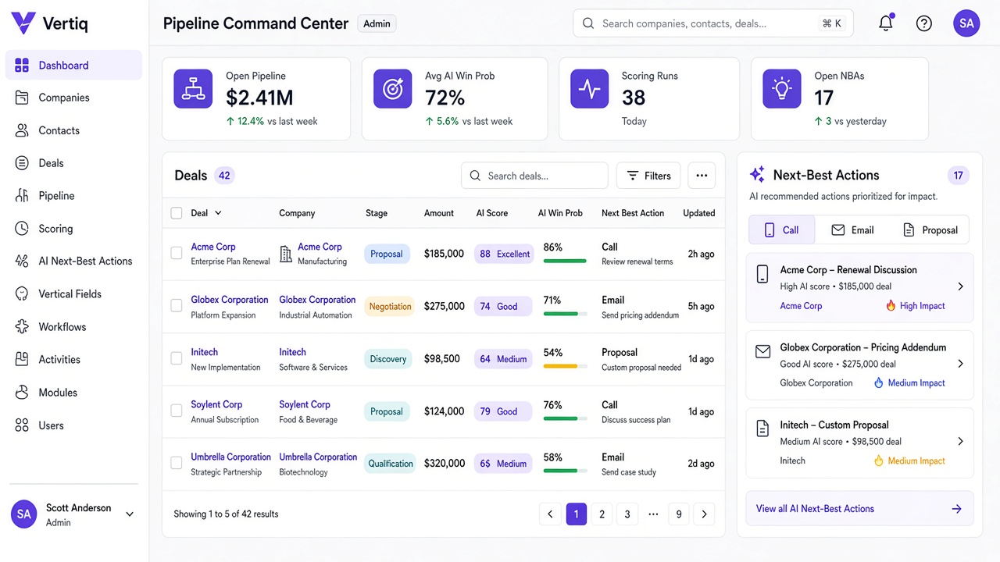

# Vertical CRM with Embedded AI



**SEO title:** Vertical CRM with Embedded AI | Pipeline Scoring, Next-Best Actions & Revenue Workflows  
**SEO description:** Vertical CRM with embedded AI for pipeline scoring, next-best actions, industry fields, and revenue workflows tailored to specialized businesses.  
**Keywords:** vertical CRM software, embedded AI CRM, pipeline scoring AI, next best action CRM, industry custom fields CRM, revenue workflow automation, Laravel Filament CRM, niche sales CRM, dental legal HVAC CRM  
**Author:** Imran Ahmed \<me@imrandev.bd\> · [imrandev.bd](https://imrandev.bd)  
**Accent:** `#4F46E5` · **Industry:** Vertical / Specialized Sales  
**Repository:** [github.com/imranbru99/vertical-crm-embedded-ai](https://github.com/imranbru99/vertical-crm-embedded-ai)

---

## Why this product exists

Generic CRMs flatten specialized businesses into the same contact/deal grid. Dental groups need chair utilization fields; law firms need practice-area intake; HVAC operators need service-zone coverage. Meanwhile sellers drown in stale stages with no explainable win probability and no prioritized next step.

**Vertical CRM with Embedded AI (Vertiq)** is a complete Laravel + Filament business solution for niche revenue teams: contacts, deals, configurable pipeline, scoring AI, next-best actions, vertical fields, revenue workflows, and activities. Every module is toggleable so a single-vertical boutique or multi-niche revenue org runs only what they need.

### Business ROI & time-saver case

| Bottleneck | Without Vertiq | With Vertiq | Typical savings |
|---|---|---|---|
| Pipeline hygiene | Manual stage guessing | Stage + AI score on every deal | **20–40 min / day / AE** |
| Prioritization | Inbox noise | Ranked next-best actions | **1–2 hrs / week / rep** |
| Vertical data | Spreadsheet side fields | Native industry fields | **30–60 min / deal setup** |
| Forecast trust | Optimistic commit lists | Explainable scoring signals | **Cleaner weekly forecast** |
| Playbook handoff | Slack tribal knowledge | Revenue workflows + SLAs | **Hours off stage lag** |
| Module sprawl | Pay for unused CRM seats | Toggle modules off | **Lower ops overhead** |

For a 12-rep specialized sales team, reclaiming even **30 minutes per rep per day** plus earlier NBA follow-through routinely unlocks **20–40+ hours/month** of selling time — before win-rate lift from better prioritization.

---

## Product screenshot

The admin dashboard (indigo `#4F46E5` theme) surfaces open pipeline value, average AI win probability, scoring runs, and open next-best actions — designed for vertical revenue operators, not generic CRM chrome.

---

## Core modules (all toggleable)

Every module can be enabled/disabled via `.env`, `config/modules.php`, or the **Modules** Filament resource (`module_settings` table). Disabled modules hide from navigation and refuse resource access.

| Module key | Label | What it does |
|---|---|---|
| `contacts` | Contacts | People records with lifecycle, vertical, and ownership |
| `deals` | Deals | Opportunities with amount, close date, and forecast category |
| `pipeline` | Pipeline | Configurable stages, probabilities, won/lost terminals |
| `scoring_ai` | Scoring AI | Embedded win-probability scoring with signal breakdown |
| `next_best_actions` | Next-Best Actions | Ranked calls, emails, and tasks by revenue impact |
| `vertical_fields` | Vertical Fields | Industry-specific field definitions (dental, legal, HVAC, …) |
| `revenue_workflows` | Revenue Workflows | Triggered playbooks with SLAs and run history |
| `activities` | Activities | Calls, meetings, notes tied to contacts and deals |

---

## Multi-role users

| Role | Access |
|---|---|
| Super Admin | Full control, modules, users, workflows |
| Admin | CRM administration |
| Manager | Pipeline oversight, scoring, NBA assignment |
| Staff | AE deal/contact/activity execution |
| Client / Customer | Portal-only opportunity visibility |
| Demo | Seeded showcase user for evaluations |

### Demo credentials (after `db:seed`)

| User | Email | Password |
|---|---|---|
| Demo | `demo@vertiq.test` | `password` |
| Super Admin | `superadmin@vertiq.test` | `password` |
| Admin | `admin@vertiq.test` | `password` |
| Manager | `manager@vertiq.test` | `password` |
| Staff | `staff@vertiq.test` | `password` |
| Client | `client@vertiq.test` | `password` |

---

## Public marketing pages

| Route | Purpose |
|---|---|
| `/` | Hero + live module grid |
| `/features` | Feature deep-dive for revenue teams |
| `/modules` | Toggleable module catalog with ON/OFF status |
| `/pricing` | Starter / Growth / Enterprise framing |
| `/security` | Role gates & module accountability |
| `/demo` | Demo credentials CTA |
| `/admin` | Filament admin panel (Vertiq) |
| `/portal` | Authenticated client opportunity portal |

---

## Technical stack

- **PHP 8.4 / Laravel 13** application core  
- **Filament 5** admin panel (indigo primary `#4F46E5`)  
- **Livewire** interactive admin UI  
- Modular services: `ModuleManager`, `PipelineService`, `ScoringAiService`, `NextBestActionService`, `RevenueWorkflowService`, `VerticalFieldService`, `ContactService`, `ActivityService`  
- Migrations, models, seeders, feature test stubs  
- Dockerized (`Dockerfile` + `docker-compose.yml`) with MySQL  

### Packagist packages (`imrandevbd/*`)

| Package | Role in this product |
|---|---|
| `imrandevbd/drutogoti` | Performance / speed helpers |
| `imrandevbd/laravel-admin-panel` | Admin panel extensions |
| `imrandevbd/laravel-ai-catalog` | Catalog / enrichment patterns for accounts & vertical data |
| `imrandevbd/laravel-ai-hub` | Multi-provider AI for scoring & NBA generation |
| `imrandevbd/laravel-attendance-hub` | Optional field/rep presence integrations |
| `imrandevbd/laravel-unicode-pdf` | Multilingual proposal / pipeline PDFs |
| `imrandevbd/laravel-universal-slug` | Unicode-safe slugs for companies & deals |

> **Note:** On Laravel 13, Packagist builds of `drutogoti`, `laravel-admin-panel`, and `laravel-attendance-hub` currently constrain `illuminate/*` to ^11\|^12. This repo declares all seven packages at `dev-main` and ships L13 path compatibility bridges under `packages/` so the application installs cleanly while upstream catches up. `laravel-ai-hub`, `laravel-unicode-pdf`, and `laravel-universal-slug` install from Packagist. `laravel-ai-catalog` uses a local bridge because Packagist `dev-main` requires `laravel-ai-hub:^1.6` which conflicts with root `dev-main`.

---

## Quick start (local)

```bash
composer install
cp .env.example .env
php artisan key:generate
touch database/database.sqlite   # or configure MySQL
php artisan migrate --seed
php artisan serve
```

- Marketing site: [http://127.0.0.1:8000](http://127.0.0.1:8000)  
- Admin: [http://127.0.0.1:8000/admin](http://127.0.0.1:8000/admin)  

### Docker

```bash
docker compose up --build
```

App: [http://localhost:8080](http://localhost:8080) · MySQL published on host `3307`.

---

## Architecture highlights

```
app/
  Enums/UserRole.php
  Filament/Resources/{Companies,Contacts,Deals,PipelineStages,PipelineScores,NextBestActions,VerticalFields,RevenueWorkflows,Activities,ModuleSettings,Users}
  Filament/Widgets/{CrmStatsOverview,RecentDealsWidget}
  Models/{Company,Contact,Deal,PipelineStage,PipelineScore,NextBestAction,VerticalField,RevenueWorkflow,Activity,ModuleSetting}
  Services/{ModuleManager,PipelineService,ScoringAiService,NextBestActionService,RevenueWorkflowService,VerticalFieldService,ContactService,ActivityService}
  Http/Controllers/{MarketingController,PortalController}
config/modules.php
config/crm.php
```

---

## Opportunities & roadmap ideas

- Multi-pipeline support per vertical brand  
- Conversation intelligence feeding scoring signals  
- Marketplace of vertical field packs  
- Slack / Teams NBA delivery  
- Forecast commit vs AI probability reconciliation  
- Partner portal for channel sales motions  

---

## License & authorship

MIT-licensed portfolio application.  
**Author / committer:** Imran Ahmed \<me@imrandev.bd\> — [https://imrandev.bd](https://imrandev.bd)

---

## 🤝 Let's Connect & Collaborate

I am open to Senior Remote Full-Stack Roles, AI Platform Architecture Contracts, and Enterprise Technical Advisory.

Timezone: UTC+6 (Dhaka / Rangpur, Bangladesh) — Flexible overlap with US, UK, and European business hours.

Delivery Mode: Async-ready, Slack, Discord, Jira, GitHub, and production-first accountability.

| Channel | Address / Handle | Quick Action |
|---|---|---|
| 🌐 Primary Portfolio | [imrandev.bd](https://imrandev.bd) | [Visit Site ↗](https://imrandev.bd) |
| 📦 Packagist Packages | [packagist.org/packages/imrandevbd/](https://packagist.org/packages/imrandevbd/) | [View Packages ↗](https://packagist.org/packages/imrandevbd/) |
| 💼 LinkedIn Profile | [linkedin.com/in/imranbru99](https://linkedin.com/in/imranbru99) | [Connect ↗](https://linkedin.com/in/imranbru99) |
| 🐙 GitHub Profile | [github.com/imranbru99](https://github.com/imranbru99) | [Follow ↗](https://github.com/imranbru99) |
| 💬 WhatsApp Direct | +880 1576-918420 | [Chat Now ↗](https://wa.me/8801576918420) |
| 📧 Direct Email | me@imrandev.bd | [Send Email ↗](mailto:me@imrandev.bd) |
| 🐦 X (Twitter) | [@imrandev_bd](https://x.com/imrandev_bd) | [Follow ↗](https://x.com/imrandev_bd) |
| 📺 YouTube Tech | [@ImranDevBD](https://youtube.com/@ImranDevBD) | [Subscribe ↗](https://youtube.com/@ImranDevBD) |
